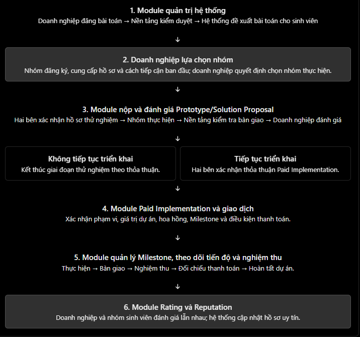

## **I. Module nộp và đánh giá Prototype/Solution Proposal**

### **1. Mục đích chức năng**
Module này hỗ trợ nhóm sinh viên gửi bản đề xuất giải pháp (Solution Proposal) hoặc bản mẫu thử nghiệm (Prototype) để doanh nghiệp xem xét sau khi đã lựa chọn nhóm thực hiện.
Module có các chức năng chính:

- Ghi nhận hồ sơ dự án thử nghiệm đã được hai bên thống nhất trước khi thực hiện Prototype.
- Cho phép nhóm sinh viên nộp sản phẩm, tài liệu và các tệp liên quan đến bài toán.
- Hỗ trợ nền tảng kiểm tra tính đầy đủ của sản phẩm bàn giao trước khi chuyển cho doanh nghiệp.
- Cho phép doanh nghiệp đánh giá sản phẩm, phản hồi và yêu cầu chỉnh sửa trong phạm vi đã thống nhất.
- Ghi nhận kết quả thử nghiệm làm căn cứ để kết thúc giai đoạn Prototype hoặc chuyển sang Paid Implementation.

Trong đó, Solution Proposal là bản đề xuất hướng giải quyết bài toán; Prototype là phiên bản thử nghiệm nhằm kiểm chứng tính khả thi của giải pháp, chưa phải sản phẩm hoàn chỉnh để đưa vào sử dụng chính thức.

### **2. Đối tượng sử dụng và quyền hạn**

| **Đối tượng liên quan** | **Vai trò và quyền hạn** |
| --- | --- |
| Doanh nghiệp | Tạo và xác nhận hồ sơ dự án thử nghiệm; thống nhất mục tiêu, phạm vi và thời hạn; xem sản phẩm; đưa ra kết quả đánh giá và yêu cầu chỉnh sửa. |
| Nhóm sinh viên | Xem yêu cầu của bài toán; xác nhận hoặc đề nghị điều chỉnh hồ sơ thử nghiệm; thực hiện, nộp và chỉnh sửa Solution Proposal/Prototype. |
| Quản trị viên/nền tảng | Ghi nhận và quản lý hồ sơ dự án; kiểm tra tính đầy đủ của sản phẩm bàn giao; theo dõi trạng thái, thông báo và hỗ trợ xử lý vấn đề phát sinh. |
| Chuyên gia/mentor (nếu có) | Thực hiện Expert Review khi doanh nghiệp có nhu cầu hoặc dự án cần đánh giá chuyên môn bổ sung. Đây là dịch vụ tùy chọn, không phải bước bắt buộc của mọi dự án. |

### **3. Điểm truy cập chức năng**

- Doanh nghiệp: Truy cập trang quản lý dự án sau khi lựa chọn nhóm sinh viên, chọn chức năng tạo hồ sơ dự án thử nghiệm và gửi hồ sơ cho nhóm xác nhận.
- Nhóm sinh viên: Truy cập trang quản lý dự án của nhóm để xem hồ sơ, xác nhận điều kiện thực hiện và nộp Solution Proposal/Prototype.
- Quản trị viên/nền tảng: Truy cập khu vực quản lý dự án để theo dõi hồ sơ, tình trạng bàn giao và các trường hợp cần hỗ trợ.

Dự án chỉ chuyển sang trạng thái “Đang thực hiện Prototype” sau khi doanh nghiệp và nhóm sinh viên xác nhận hồ sơ thử nghiệm.

### **4. Giao diện và thành phần hiển thị**
a. Màn hình hồ sơ dự án thử nghiệm
Giao diện hiển thị các thông tin:

- Tên dự án, doanh nghiệp và nhóm sinh viên thực hiện.
- Mục tiêu, mô tả bài toán và phạm vi công việc.
- Sản phẩm đầu ra cần bàn giao.
- Thời hạn thực hiện và các mốc công việc nếu có.
- Tiêu chí đánh giá và số lần chỉnh sửa được thống nhất.
- Dữ liệu doanh nghiệp cung cấp và yêu cầu bảo mật.
- Quyền sử dụng, quyền sở hữu sản phẩm và trách nhiệm của các bên.
- Quyền lợi hoặc thù lao của giai đoạn thử nghiệm, nếu có.
- Trạng thái xác nhận và lịch sử điều chỉnh hồ sơ.

b. Màn hình nộp sản phẩm
Màn hình hiển thị tên dự án, thời hạn bàn giao, yêu cầu công việc và danh sách sản phẩm cần nộp. Nhóm sinh viên có thể nhập tiêu đề, mô tả hướng giải quyết, ghi chú bàn giao và tải lên tệp như PDF, hình ảnh, bản thiết kế giao diện hoặc đường dẫn bản demo.
c. Màn hình kiểm tra bàn giao và đánh giá
Màn hình của nền tảng hiển thị tình trạng nộp sản phẩm, tệp đính kèm và các tài liệu cần thiết để kiểm tra tính đầy đủ.
Màn hình đánh giá của doanh nghiệp hiển thị sản phẩm đã nộp, thời gian bàn giao, tiêu chí đánh giá và các điều khoản đã thống nhất. Doanh nghiệp có thể chọn một trong các kết quả:

- Chấp nhận: Sản phẩm đáp ứng yêu cầu thử nghiệm.
- Yêu cầu chỉnh sửa: Sản phẩm cần được bổ sung hoặc điều chỉnh.
- Không tiếp tục triển khai: Doanh nghiệp không có nhu cầu chuyển sang giai đoạn triển khai thực tế.

Khi yêu cầu chỉnh sửa hoặc không tiếp tục triển khai, doanh nghiệp cần ghi rõ lý do để hệ thống lưu lại.

### **5. Luồng xử lý và phản hồi của hệ thống**
Bước 1. Thống nhất hồ sơ dự án thử nghiệm

1. Doanh nghiệp tạo hồ sơ dự án thử nghiệm, xác định mục tiêu, sản phẩm đầu ra, thời hạn, phạm vi chỉnh sửa và các điều khoản liên quan.
1. Nhóm sinh viên xem xét hồ sơ và chọn xác nhận hoặc đề nghị điều chỉnh.
1. Nếu nhóm đề nghị điều chỉnh, doanh nghiệp cập nhật hồ sơ để hai bên thống nhất lại.
1. Khi cả hai bên xác nhận, hệ thống lưu phiên bản cuối cùng và chuyển dự án sang trạng thái “Đang thực hiện Prototype”.

Bước 2. Thực hiện và nộp sản phẩm

1. Nhóm sinh viên thực hiện Solution Proposal/Prototype theo hồ sơ đã xác nhận.
1. Nhóm tải sản phẩm lên hệ thống và nhấn “Nộp”.
1. Hệ thống kiểm tra thông tin bắt buộc, tệp đính kèm và thời hạn bàn giao.
1. Nếu hợp lệ, hệ thống lưu sản phẩm, ghi nhận thời gian nộp và chuyển sang bước kiểm tra bàn giao.
1. Nền tảng kiểm tra tính đầy đủ của sản phẩm, tài liệu, loại/dung lượng tệp, thời hạn và đối chiếu với danh sách sản phẩm đầu ra trong hồ sơ thử nghiệm. Solution Proposal thuần văn bản hợp lệ khi nội dung đạt độ dài tối thiểu; Prototype bắt buộc có tệp hoặc URL demo. AI chỉ đối chiếu đầu ra, không chấm chất lượng và không chặn nộp bài khi AI lỗi.
1. Khi sản phẩm đáp ứng điều kiện bàn giao, hệ thống chuyển sản phẩm cho doanh nghiệp và cập nhật trạng thái “Chờ doanh nghiệp đánh giá”. Nếu thiếu tài liệu hoặc chưa đáp ứng điều kiện, hệ thống thông báo để nhóm bổ sung.

Bước 3. Doanh nghiệp đánh giá sản phẩm

- Nếu doanh nghiệp chọn “Chấp nhận”, hệ thống lưu kết quả và ghi nhận sản phẩm đã đạt yêu cầu thử nghiệm.
- Nếu doanh nghiệp chọn “Yêu cầu chỉnh sửa”, hệ thống lưu lý do, chuyển trạng thái sang “Cần chỉnh sửa” và thông báo cho nhóm sinh viên.
- Nếu doanh nghiệp chọn “Không tiếp tục triển khai”, hệ thống lưu lý do và kết thúc giai đoạn Prototype theo thỏa thuận. Không tự động phát sinh giao dịch Paid Implementation.

Bước 4. Xử lý các tình huống phát sinh

- Nếu nhóm sinh viên nộp muộn, hệ thống ghi nhận tình trạng quá hạn và thông báo cho các bên liên quan.
- Nếu doanh nghiệp chậm phản hồi, hệ thống gửi thông báo nhắc nhở và ghi nhận tình trạng quá hạn phản hồi. Việc chậm phản hồi không được xem là tự động chấp nhận sản phẩm.
- Nếu hai bên bất đồng về kết quả, hệ thống lưu sản phẩm bàn giao, nhận xét và lịch sử trao đổi để hỗ trợ xử lý.
- Việc gia hạn, tạm dừng hoặc kết thúc dự án được thực hiện theo thỏa thuận đã xác nhận.

Cần phân biệt hai quyết định: sản phẩm Prototype có đạt yêu cầu hay không và doanh nghiệp có muốn đầu tư triển khai giải pháp hay không. Một Prototype đạt yêu cầu vẫn có thể kết thúc mà không chuyển sang Paid Implementation nếu doanh nghiệp thay đổi kế hoạch hoặc chưa có ngân sách.

### **6. Dữ liệu đầu vào, đầu ra và lưu trữ**
Hệ thống lưu trữ các nhóm dữ liệu:

- Thông tin dự án: Mã dự án, mã doanh nghiệp, mã nhóm sinh viên, thời hạn và trạng thái dự án.
- Hồ sơ thử nghiệm: Mục tiêu, phạm vi công việc, sản phẩm đầu ra, tiêu chí đánh giá, số lần chỉnh sửa và điều khoản đã thống nhất.
- Dữ liệu bàn giao: Tiêu đề, nội dung Solution Proposal, tệp đính kèm, phiên bản Prototype, người nộp và thời gian nộp.
- Dữ liệu kiểm tra: Tình trạng đầy đủ của sản phẩm, tài liệu cần bổ sung và kết quả kiểm tra bàn giao.
- Dữ liệu đánh giá: Người đánh giá, kết quả, nhận xét, thời gian đánh giá và lịch sử yêu cầu chỉnh sửa.
- Dữ liệu phát sinh: Thông báo quá hạn, yêu cầu gia hạn, ý kiến bất đồng và kết quả xử lý.

Các dữ liệu được liên kết với hồ sơ dự án để phục vụ việc theo dõi và đối chiếu.

### **7. Mã kết quả đánh giá và kết thúc Prototype**

- `ProposalEvaluation.evaluationResult`: `ACCEPTED`, `REVISION_REQUESTED` hoặc `STOPPED`. `STOPPED` lưu lý do trong nhận xét đánh giá.
- `Problem.implementationDecision`: sau `ACCEPTED`, là `PENDING` cho tới khi doanh nghiệp chọn `IMPLEMENT` hoặc `ENDED`.
- `PrototypeClosure.result`: `ENDED_AFTER_ACCEPTANCE` khi kết thúc sau khi đã chấp nhận Prototype; `ENDED_WITHOUT_SUBMISSION` khi doanh nghiệp kết thúc lúc không có lần nộp nào đang chờ Admin kiểm tra.
- `Problem.status` là trạng thái quy trình, không thay thế các kết quả trên. `ACCEPTED + PENDING` vẫn ở `EVALUATING`; `ACCEPTED + IMPLEMENT` chuyển sang `READY_FOR_IMPLEMENTATION`; `ACCEPTED + ENDED` và `STOPPED` chuyển sang `CLOSED`.
- `IMPLEMENT` chỉ mở cổng soạn thỏa thuận. Không tạo `Project`, `PlatformCharge` hoặc `ProjectTransaction` cho tới các bước giao dịch riêng.

## **II. Module Paid Implementation và giao dịch**

### **1. Mục đích chức năng**
Module này hỗ trợ doanh nghiệp và nhóm sinh viên chính thức thỏa thuận triển khai giải pháp vào thực tế sau khi kết quả Solution Proposal/Prototype được đánh giá phù hợp và doanh nghiệp có nhu cầu tiếp tục thực hiện.
Các chức năng chính gồm:

- Tạo, điều chỉnh và xác nhận thỏa thuận triển khai.
- Ghi nhận phạm vi công việc, giá trị dự án, thời hạn và sản phẩm bàn giao.
- Xác định các mốc công việc và điều kiện thanh toán.
- Tính khoản hoa hồng dự kiến của nền tảng theo tỷ lệ được cấu hình.
- Theo dõi trạng thái giao dịch và các khoản thanh toán liên quan.

### **2. Đối tượng sử dụng và quyền hạn**

| **Đối tượng liên quan** | **Vai trò và quyền hạn** |
| --- | --- |
| Doanh nghiệp | Tạo thỏa thuận triển khai, thống nhất giá trị dự án, xác nhận điều kiện và thực hiện nghĩa vụ thanh toán. |
| Nhóm sinh viên | Xem, phản hồi và xác nhận thỏa thuận; thực hiện công việc và theo dõi thông tin giao dịch liên quan đến dự án. |
| Quản trị viên/nền tảng | Quản lý hồ sơ giao dịch, ghi nhận khoản hoa hồng theo chính sách, theo dõi trạng thái thanh toán và hỗ trợ xử lý vấn đề phát sinh. |

### **3. Điểm truy cập chức năng**
Sau khi doanh nghiệp chấp nhận kết quả thử nghiệm và quyết định tiếp tục triển khai, doanh nghiệp truy cập trang chi tiết dự án và chọn “Tạo thỏa thuận triển khai”.
Nhóm sinh viên nhận thông báo, truy cập mục “Thỏa thuận dự án” để xem và phản hồi các điều kiện.
Dự án chỉ chuyển sang trạng thái “Paid Implementation - Chờ triển khai” sau khi cả doanh nghiệp và nhóm sinh viên xác nhận thỏa thuận.

### **4. Giao diện và thành phần hiển thị**
Màn hình thỏa thuận triển khai hiển thị:

- Thông tin dự án, doanh nghiệp và nhóm thực hiện.
- Phạm vi công việc và sản phẩm đầu ra.
- Thời gian thực hiện và số lần chỉnh sửa.
- Các Milestone và tiêu chí nghiệm thu.
- Giá trị dự án, phương thức và điều kiện thanh toán.
- Giá trị thanh toán tương ứng với từng Milestone.
- Tỷ lệ hoa hồng và khoản hoa hồng dự kiến của nền tảng.
- Quyền sử dụng, quyền sở hữu sản phẩm, nghĩa vụ bảo mật và trách nhiệm của các bên.
- Điều kiện gia hạn, tạm dừng, chấm dứt thỏa thuận và xử lý bất đồng.
- Trạng thái xác nhận và lịch sử điều chỉnh thỏa thuận.

Ví dụ minh họa về hoa hồng
Giả sử dự án có giá trị 10.000.000 đồng và tỷ lệ hoa hồng dự kiến là 15%:

| **Nội dung** | **Giá trị** |
| --- | --- |
| Giá trị dự án | 10.000.000 đồng |
| Hoa hồng nền tảng (15%) | 1.500.000 đồng |
| Phần còn lại dành cho nhóm thực hiện | 8.500.000 đồng |
Đây là ví dụ minh họa cách tính theo giả định tỷ lệ hoa hồng 15%. Việc thu phí, thời điểm khấu trừ và thanh toán thực tế phải tuân theo chính sách nền tảng và thỏa thuận áp dụng.

### **5. Luồng xử lý và phản hồi của hệ thống**
Bước 1. Tạo thỏa thuận triển khai

1. Doanh nghiệp nhập phạm vi công việc, sản phẩm đầu ra, thời hạn, giá trị dự án và điều kiện thanh toán.
1. Hệ thống kiểm tra các trường thông tin bắt buộc.
1. Nếu thông tin hợp lệ, hệ thống lưu thỏa thuận ở trạng thái “Chờ nhóm sinh viên xác nhận”.

Bước 2. Xác nhận thỏa thuận

- Nhóm sinh viên chọn “Đồng ý” nếu chấp nhận các điều kiện.
- Nếu cần thay đổi, nhóm chọn “Đề nghị điều chỉnh” và ghi rõ nội dung.
- Doanh nghiệp xem xét, cập nhật thỏa thuận và gửi lại để nhóm xác nhận.
- Khi cả hai bên đồng ý, hệ thống lưu phiên bản thỏa thuận cuối cùng và tạo hồ sơ Paid Implementation.

Nếu một bên chưa xác nhận, dự án chưa được chuyển sang giai đoạn triển khai chính thức.
Bước 3. Ghi nhận giao dịch và tạo Milestone
Sau khi thỏa thuận được xác nhận, hệ thống:

1. Ghi nhận giá trị dự án và tỷ lệ hoa hồng áp dụng.
1. Tính khoản hoa hồng dự kiến.
1. Ghi nhận các Milestone và giá trị thanh toán tương ứng.
1. Liên kết hồ sơ giao dịch với module quản lý Milestone để theo dõi tiến độ, bàn giao và nghiệm thu.

Bước 4. Theo dõi thanh toán và xử lý phát sinh

- Khi đến điều kiện thanh toán của từng Milestone, hệ thống ghi nhận trạng thái thanh toán tương ứng.
- Nếu một bên đề nghị gia hạn, tạm dừng hoặc chấm dứt dự án, hệ thống lưu lý do, thời gian và xác nhận liên quan.
- Nếu phát sinh bất đồng, hệ thống lưu thỏa thuận và lịch sử giao dịch để hỗ trợ xử lý.
- Các khoản thanh toán đã phát sinh được xử lý theo thỏa thuận và chính sách áp dụng.

Đối với bản MVP chưa tích hợp cổng thanh toán trực tuyến, chức năng có thể dừng ở mức tạo thỏa thuận, tính toán khoản tiền và mô phỏng cập nhật trạng thái giao dịch. Khi đó, báo cáo không được khẳng định hệ thống đã tự động thu hoặc chuyển tiền thành công.

### **6. Dữ liệu đầu vào, đầu ra và lưu trữ**
Hệ thống lưu trữ:

- Thông tin giao dịch: Mã giao dịch, mã dự án, mã doanh nghiệp và mã nhóm sinh viên.
- Thông tin tài chính: Giá trị dự án, tỷ lệ hoa hồng, khoản hoa hồng dự kiến, số tiền dành cho nhóm thực hiện và phương thức thanh toán.
- Thông tin thỏa thuận: Phạm vi công việc, sản phẩm đầu ra, thời hạn, điều kiện nghiệm thu và thanh toán.
- Lịch sử xác nhận: Người xác nhận, thời gian xác nhận, phiên bản thỏa thuận và lịch sử điều chỉnh.
- Trạng thái giao dịch: Tình trạng thỏa thuận, các khoản thanh toán và thời điểm cập nhật.
- Dữ liệu phát sinh: Yêu cầu gia hạn, tạm dừng, chấm dứt hoặc thông tin bất đồng.

Các dữ liệu được liên kết với dự án và Milestone để phục vụ việc đối chiếu trong quá trình triển khai.

## **III. Module quản lý Milestone, theo dõi tiến độ và nghiệm thu**

### **1. Mục đích chức năng**
Module hỗ trợ doanh nghiệp và nhóm sinh viên quản lý quá trình thực hiện dự án Paid Implementation thông qua các mốc công việc (Milestone).
Các chức năng chính gồm:

- Chia dự án thành các Milestone có thời hạn và đầu ra cụ thể.
- Cho phép nhóm sinh viên cập nhật tiến độ và nộp sản phẩm bàn giao.
- Cho phép doanh nghiệp kiểm tra, yêu cầu chỉnh sửa và xác nhận nghiệm thu.
- Theo dõi trạng thái nghiệm thu và các khoản thanh toán tương ứng.
- Ghi nhận trường hợp quá hạn, chậm phản hồi, tạm dừng hoặc phát sinh bất đồng.

### **2. Đối tượng sử dụng và quyền hạn**

| **Đối tượng liên quan** | **Vai trò và quyền hạn** |
| --- | --- |
| Nhóm sinh viên | Xem nhiệm vụ, cập nhật tiến độ, nộp sản phẩm và chỉnh sửa theo phản hồi. |
| Doanh nghiệp | Theo dõi tiến độ, kiểm tra sản phẩm, đưa ra nhận xét và xác nhận nghiệm thu từng mốc. |
| Quản trị viên/nền tảng | Theo dõi trạng thái dự án, quản lý thông tin và hỗ trợ xử lý trường hợp chậm tiến độ hoặc phát sinh bất đồng. |

### **3. Điểm truy cập chức năng**
Doanh nghiệp và nhóm sinh viên truy cập trang chi tiết dự án đã được xác nhận Paid Implementation, sau đó chọn mục “Milestone và tiến độ”.
Tại đây, người dùng xem danh sách mốc công việc và thực hiện thao tác tương ứng với quyền hạn của mình.

### **4. Giao diện và thành phần hiển thị**
a. Màn hình tổng quan dự án
Hiển thị tên dự án, doanh nghiệp, nhóm thực hiện, ngày bắt đầu, hạn hoàn thành và tiến độ tổng thể.
b. Danh sách Milestone
Mỗi Milestone gồm:

- Tên và mô tả công việc.
- Thời hạn hoàn thành.
- Sản phẩm đầu ra cần bàn giao.
- Tiêu chí nghiệm thu.
- Tỷ lệ và giá trị thanh toán tương ứng.
- Trạng thái thực hiện.

Các trạng thái dự kiến gồm: “Chưa bắt đầu”, “Đang thực hiện”, “Chờ nghiệm thu”, “Cần chỉnh sửa”, “Đã nghiệm thu”, “Quá hạn”, “Chờ xử lý quá hạn phản hồi”, “Tạm dừng” và “Có bất đồng - Chờ xử lý”.
c. Màn hình bàn giao và lịch sử công việc
Màn hình hiển thị tệp bàn giao, đường dẫn sản phẩm, lịch sử cập nhật tiến độ, nhận xét của doanh nghiệp, yêu cầu chỉnh sửa và thời gian thực hiện từng thao tác.
Ví dụ minh họa về phân chia thanh toán
Với dự án trị giá 10.000.000 đồng, hai bên có thể thống nhất chia thành ba Milestone:

| **Milestone** | **Tỷ lệ** | **Giá trị** |
| --- | --- | --- |
| Mốc 1 | 30% | 3.000.000 đồng |
| Mốc 2 | 40% | 4.000.000 đồng |
| Mốc 3 | 30% | 3.000.000 đồng |
| Tổng cộng | 100% | 10.000.000 đồng |
Đây là ví dụ minh họa. Tỷ lệ và giá trị thanh toán thực tế được xác định trong thỏa thuận Paid Implementation.

### **5. Luồng xử lý và phản hồi của hệ thống**
Bước 1. Cập nhật tiến độ

1. Nhóm sinh viên mở Milestone cần thực hiện.
1. Nhóm cập nhật phần trăm hoàn thành, công việc đã thực hiện và khó khăn gặp phải.
1. Hệ thống lưu thông tin và cập nhật tiến độ của mốc công việc.

Bước 2. Bàn giao sản phẩm

1. Nhóm sinh viên tải lên tệp hoặc cung cấp đường dẫn sản phẩm.
1. Hệ thống ghi nhận người nộp, thời gian bàn giao và phiên bản sản phẩm.
1. Trạng thái Milestone chuyển sang “Chờ nghiệm thu”.
1. Doanh nghiệp nhận thông báo để kiểm tra sản phẩm.

Bước 3. Nghiệm thu sản phẩm
Doanh nghiệp xem sản phẩm và chọn một trong hai kết quả:

- Nghiệm thu: Hệ thống lưu kết quả, người xác nhận và thời gian nghiệm thu; đồng thời cập nhật tiến độ dự án.
- Yêu cầu chỉnh sửa: Doanh nghiệp ghi rõ nội dung cần sửa. Hệ thống chuyển trạng thái sang “Cần chỉnh sửa” và thông báo cho nhóm sinh viên.

Khi Milestone đáp ứng điều kiện thanh toán theo thỏa thuận, hệ thống ghi nhận trạng thái thanh toán tương ứng hoặc chuyển thông tin sang module giao dịch để xử lý.
Bước 4. Xử lý tình huống phát sinh

| **Tình huống** | **Xử lý của hệ thống** |
| --- | --- |
| Nhóm sinh viên nộp muộn | Ghi nhận tình trạng quá hạn, thông báo cho các bên và lưu thời gian chậm tiến độ. |
| Doanh nghiệp chậm nghiệm thu | Gửi thông báo nhắc nhở và ghi nhận tình trạng “Chờ xử lý quá hạn phản hồi”; không tự động xem sản phẩm là đã nghiệm thu. |
| Hai bên bất đồng về kết quả | Lưu sản phẩm bàn giao, nhận xét và lịch sử trao đổi; chuyển trạng thái sang “Có bất đồng - Chờ xử lý”. |
| Một bên đề nghị gia hạn | Ghi nhận yêu cầu, cập nhật thời hạn khi được thống nhất và lưu lịch sử thay đổi. |
| Hai bên thống nhất tạm dừng hoặc hủy Milestone | Lưu lý do, người đề nghị, thời gian và xác nhận của các bên; xử lý theo thỏa thuận. |
Bước 5. Nghiệm thu cuối cùng
Khi các Milestone bắt buộc đã hoàn thành và được xử lý theo thỏa thuận, hệ thống chuyển dự án sang trạng thái “Chờ nghiệm thu cuối cùng”.
Sau khi doanh nghiệp xác nhận kết quả cuối cùng, hệ thống cập nhật dự án thành “Hoàn tất” và chuyển thông tin liên quan sang module giao dịch để đối chiếu các khoản thanh toán còn lại.
Trạng thái nghiệm thu và trạng thái thanh toán phải được quản lý riêng biệt. Việc doanh nghiệp xác nhận hoàn thành không đồng nghĩa với việc tiền đã được chuyển thành công.

### **6. Dữ liệu đầu vào, đầu ra và lưu trữ**
Hệ thống lưu trữ:

- Thông tin Milestone: Mã dự án, mã Milestone, tên mốc, mô tả, thời hạn và tiêu chí nghiệm thu.
- Thông tin tiến độ: Phần trăm hoàn thành, nội dung cập nhật và thời điểm cập nhật.
- Thông tin thanh toán: Tỷ lệ, giá trị thanh toán và trạng thái thanh toán theo từng mốc.
- Dữ liệu bàn giao: Tệp sản phẩm, đường dẫn, người nộp, thời gian nộp và lịch sử phiên bản.
- Dữ liệu nghiệm thu: Người đánh giá, kết quả, nhận xét và thời gian xác nhận.
- Dữ liệu phát sinh: Thời gian quá hạn, lịch sử nhắc nhở, yêu cầu gia hạn, tạm dừng, bất đồng và kết quả xử lý.

Các dữ liệu được liên kết với hồ sơ dự án và giao dịch để phục vụ việc theo dõi tiến độ, nghiệm thu và đối chiếu thanh toán.

## **IV. Module Rating và Reputation**

### **1. Mục đích chức năng**
Module cho phép doanh nghiệp và nhóm sinh viên đánh giá lẫn nhau sau khi kết thúc quá trình hợp tác đủ điều kiện. Kết quả đánh giá được sử dụng để xây dựng hồ sơ uy tín (Reputation), giúp các bên có thêm thông tin tham khảo khi lựa chọn đối tác trong những dự án tiếp theo.
Các chức năng chính gồm:

- Gửi đánh giá và nhận xét về đối tác sau dự án.
- Tổng hợp điểm đánh giá và các chỉ số uy tín.
- Hiển thị lịch sử dự án và thông tin đánh giá được phép công khai.
- Tiếp nhận báo cáo và xử lý các đánh giá vi phạm quy định.

### **2. Đối tượng sử dụng và quyền hạn**

| **Đối tượng liên quan** | **Vai trò và quyền hạn** |
| --- | --- |
| Doanh nghiệp | Đánh giá nhóm sinh viên về chất lượng sản phẩm, mức độ đáp ứng yêu cầu, tiến độ và khả năng phối hợp. |
| Nhóm sinh viên | Đánh giá doanh nghiệp về độ rõ ràng của yêu cầu, tốc độ phản hồi, sự phối hợp và việc thực hiện cam kết. |
| Quản trị viên/nền tảng | Quản lý dữ liệu đánh giá, tiếp nhận báo cáo và xử lý đánh giá vi phạm theo chính sách. |
| Người dùng tham khảo hồ sơ | Xem các thông tin Reputation được phép công khai để hỗ trợ lựa chọn đối tác. |

### **3. Điểm truy cập chức năng**
Sau khi dự án kết thúc và đủ điều kiện đánh giá theo quy định của nền tảng, doanh nghiệp và nhóm sinh viên truy cập trang chi tiết dự án hoặc mục “Đánh giá dự án” để gửi đánh giá.
Nếu người dùng chưa đánh giá, hệ thống có thể hiển thị thông báo nhắc nhở.
Chỉ những tài khoản thực sự tham gia dự án mới được đánh giá các bên liên quan đến dự án đó.

### **4. Giao diện và thành phần hiển thị**
a. Màn hình đánh giá
Màn hình hiển thị tên dự án, đối tượng được đánh giá, thang điểm từ 1 đến 5 sao và các tiêu chí đánh giá.

- Doanh nghiệp đánh giá chất lượng sản phẩm, mức độ đáp ứng yêu cầu, tiến độ và khả năng phối hợp của nhóm sinh viên.
- Nhóm sinh viên đánh giá tính rõ ràng của yêu cầu, tốc độ phản hồi, sự hợp tác và việc thực hiện cam kết của doanh nghiệp.
- Cả hai bên có thể nhập nhận xét bổ sung về quá trình hợp tác.

b. Hồ sơ Reputation
Hồ sơ doanh nghiệp có thể hiển thị điểm đánh giá trung bình, số bài toán đã đăng, lịch sử dự án và các nhận xét được phép công khai.
Hồ sơ nhóm sinh viên có thể hiển thị điểm đánh giá, số dự án hoàn thành, tỷ lệ hoàn thành đúng hạn, lịch sử dự án và các sản phẩm được phép đưa vào Portfolio.
Thông tin công khai phải tuân thủ quy định bảo mật và quyền riêng tư của nền tảng.

### **5. Luồng xử lý và phản hồi của hệ thống**
Bước 1. Gửi đánh giá

1. Người dùng chọn số sao, nhập nhận xét và nhấn “Gửi đánh giá”.
1. Hệ thống kiểm tra tài khoản có tham gia dự án hay không, dự án đã đủ điều kiện đánh giá chưa và người dùng đã đánh giá đối tượng đó chưa.
1. Nếu hợp lệ, hệ thống lưu đánh giá và cập nhật hồ sơ Reputation.
1. Nếu không hợp lệ, hệ thống hiển thị thông báo và không ghi nhận đánh giá.

Bước 2. Cập nhật hồ sơ uy tín
Hệ thống tổng hợp các đánh giá hợp lệ và dữ liệu lịch sử dự án để cập nhật các chỉ số như điểm đánh giá trung bình, số dự án hoàn thành và tỷ lệ hoàn thành đúng hạn.
Bước 3. Xử lý đánh giá vi phạm

1. Người dùng gửi báo cáo nếu phát hiện nội dung đánh giá vi phạm quy định.
1. Quản trị viên kiểm tra nội dung và thông tin liên quan.
1. Hệ thống lưu kết quả xử lý và lý do.
1. Việc xử lý căn cứ vào chính sách nền tảng; không tự ý thay đổi điểm đánh giá chỉ vì một bên không đồng ý với kết quả.

### **6. Dữ liệu đầu vào, đầu ra và lưu trữ**
Hệ thống lưu trữ:

- Mã đánh giá, mã dự án và thông tin người đánh giá, đối tượng được đánh giá.
- Điểm tổng thể và điểm theo từng tiêu chí.
- Nội dung nhận xét và thời gian gửi.
- Trạng thái đánh giá và lịch sử báo cáo vi phạm.
- Kết quả xử lý của quản trị viên.
- Các chỉ số Reputation được tổng hợp từ đánh giá hợp lệ và lịch sử dự án.

Dữ liệu này được sử dụng để cập nhật hồ sơ uy tín và hỗ trợ người dùng lựa chọn đối tác.

## **V. Module quản trị hệ thống**

### **1. Mục đích chức năng**
Module quản trị hệ thống cho phép quản trị viên quản lý tài khoản, kiểm duyệt nội dung và theo dõi hoạt động của nền tảng. Module góp phần bảo đảm bài toán doanh nghiệp đăng lên phù hợp với quy định, thông tin dự án được quản lý minh bạch và các vấn đề phát sinh được tiếp nhận, xử lý có căn cứ.
Các chức năng chính gồm:

- Quản lý tài khoản và quyền truy cập.
- Kiểm duyệt, chuẩn hóa bài toán doanh nghiệp đăng.
- Theo dõi quá trình thực hiện dự án và trạng thái giao dịch.
- Tiếp nhận báo cáo vi phạm và hỗ trợ xử lý các trường hợp phát sinh.
- Theo dõi nhật ký hoạt động của hệ thống.

### **2. Đối tượng sử dụng và quyền hạn**

| **Đối tượng liên quan** | **Vai trò và quyền hạn** |
| --- | --- |
| Quản trị viên toàn hệ thống | Quản lý tài khoản, phân quyền và theo dõi hoạt động chung của nền tảng. |
| Nhân sự kiểm duyệt (nếu được phân quyền riêng) | Kiểm tra, chuẩn hóa và phê duyệt hoặc từ chối bài toán; xử lý báo cáo trong phạm vi được giao. |
| Doanh nghiệp | Đăng bài toán, theo dõi trạng thái kiểm duyệt và cập nhật nội dung khi được yêu cầu. Không có quyền truy cập khu vực quản trị. |
| Nhóm sinh viên | Tham gia dự án và gửi báo cáo theo quyền được cấp; không có quyền quản trị hệ thống. |

### **3. Điểm truy cập chức năng**
Quản trị viên đăng nhập bằng tài khoản có quyền phù hợp và truy cập mục “Quản trị hệ thống” trên thanh điều hướng.
Hệ thống hiển thị trang tổng quan cùng các chức năng quản lý tài khoản, kiểm duyệt bài toán, theo dõi dự án, giao dịch, đánh giá và báo cáo vi phạm.

### **4. Giao diện và thành phần hiển thị**
a. Trang tổng quan quản trị
Hiển thị các số liệu tổng hợp như:

- Số lượng tài khoản doanh nghiệp và nhóm sinh viên.
- Số bài toán đang chờ duyệt và bài toán đang mở.
- Số dự án đang thực hiện và đã hoàn tất.
- Số giao dịch hoặc trường hợp cần kiểm tra.

Các số liệu thống kê được lấy từ dữ liệu hệ thống nếu chức năng thống kê đã được triển khai.
b. Màn hình quản lý tài khoản
Hiển thị mã tài khoản, tên người dùng, loại tài khoản, email, ngày đăng ký và trạng thái hoạt động.
c. Màn hình kiểm duyệt bài toán
Hiển thị nội dung Problem, doanh nghiệp đăng, thời gian gửi và trạng thái duyệt. Quản trị viên có thể xem xét mức độ rõ ràng, phạm vi, thời gian thực hiện, đầu ra dự kiến và mức độ phù hợp với sinh viên.
d. Màn hình theo dõi dự án và giao dịch
Hiển thị mã dự án, doanh nghiệp, nhóm sinh viên, trạng thái triển khai, Milestone và trạng thái giao dịch, thanh toán.
e. Màn hình báo cáo và xử lý phát sinh
Hiển thị nội dung bị phản ánh, người gửi báo cáo, thời gian gửi, thông tin liên quan và trạng thái xử lý.

### **5. Luồng xử lý và phản hồi của hệ thống**
Bước 1. Quản lý tài khoản

1. Quản trị viên chọn tài khoản cần kiểm tra.
1. Hệ thống hiển thị thông tin chi tiết và trạng thái tài khoản.
1. Quản trị viên thực hiện thao tác trong phạm vi quyền được cấp, chẳng hạn khóa hoặc mở lại tài khoản theo chính sách.
1. Hệ thống cập nhật trạng thái và ghi lại nhật ký thao tác.

Bước 2. Kiểm duyệt và chuẩn hóa bài toán

1. Doanh nghiệp gửi bài toán lên nền tảng.
1. Hệ thống ghi nhận bài toán ở trạng thái chờ kiểm duyệt.
1. Quản trị viên hoặc nhân sự kiểm duyệt kiểm tra nội dung, phạm vi, thời hạn và đầu ra mong muốn.
1. Nếu bài toán còn chung chung, người kiểm duyệt yêu cầu doanh nghiệp bổ sung hoặc chuẩn hóa thành Problem Brief rõ ràng hơn.
1. Nếu đạt yêu cầu, bài toán được phê duyệt và chuyển sang trạng thái Open Problem.
1. Nếu bị từ chối, hệ thống lưu lý do và thông báo cho doanh nghiệp.
1. Có thể dùng AI kiểm tra sau bước luật; kết quả checklist lưu trong `AiReview`, người thực hiện tự động là “AI”, còn admin có quyền ghi đè hoặc thu hồi duyệt. Mọi ghi đè/thu hồi được ghi vào nhật ký.

Sau khi bài toán được duyệt, hệ thống phân loại và đề xuất bài toán cho sinh viên dựa trên các thông tin phù hợp như ngành học, kỹ năng, lĩnh vực quan tâm, Portfolio và lịch sử dự án. Đây là cơ chế đề xuất, không phải tự động lựa chọn nhóm thay doanh nghiệp.
Bước 3. Theo dõi dự án và giao dịch

1. Quản trị viên chọn dự án hoặc giao dịch cần kiểm tra.
1. Hệ thống hiển thị hồ sơ dự án, thỏa thuận, lịch sử bàn giao, Milestone và thông tin giao dịch liên quan.
1. Quản trị viên đối chiếu dữ liệu và hỗ trợ xử lý khi phát sinh vấn đề theo quy định.
1. Hệ thống lưu các thao tác quản trị quan trọng.

Bước 4. Tiếp nhận và xử lý báo cáo

1. Quản trị viên mở báo cáo vi phạm hoặc trường hợp cần hỗ trợ.
1. Hệ thống hiển thị nội dung báo cáo và lịch sử liên quan.
1. Quản trị viên xem xét, cập nhật kết quả xử lý và ghi rõ lý do.
1. Hệ thống lưu trạng thái xử lý để phục vụ tra cứu.

Đối với các trường hợp chậm tiến độ hoặc bất đồng giữa doanh nghiệp và nhóm sinh viên, quản trị viên có thể kiểm tra thỏa thuận, lịch sử bàn giao và xác nhận của các bên để hỗ trợ giải quyết. Quản trị viên không tự động kết luận bên nào có lỗi nếu chưa có đủ căn cứ.

### **6. Dữ liệu đầu vào, đầu ra và lưu trữ**
Hệ thống lưu trữ:

- Dữ liệu tài khoản: Mã tài khoản, thông tin người dùng, vai trò, quyền truy cập và trạng thái hoạt động.
- Dữ liệu kiểm duyệt: Mã bài toán, doanh nghiệp đăng, người duyệt (giá trị “AI” khi tự động), kết quả checklist, `AiReview`, lý do, phiên bản nội dung và thời gian xử lý; thao tác admin được lưu trong nhật ký.
- Dữ liệu dự án: Mã dự án, các bên tham gia, trạng thái triển khai, Milestone và thông tin bàn giao.
- Dữ liệu giao dịch: Mã giao dịch, giá trị dự án, trạng thái thỏa thuận và thông tin thanh toán cần theo dõi.
- Dữ liệu báo cáo: Nội dung vi phạm, người gửi, thời gian gửi, kết quả và lý do xử lý.
- Nhật ký hệ thống: Người thực hiện thao tác, hành động, đối tượng bị tác động và thời điểm thực hiện.

Các dữ liệu này phục vụ việc kiểm tra lịch sử hoạt động, quản lý quyền truy cập và hỗ trợ xử lý sự cố.

